BEND 2.0 evaluates DNA models on eight tasks, from recovering a hidden base
to choosing sequences for a desired response. Model weights stay fixed throughout.

<picture>
  <source media="(max-width: 600px) and (prefers-color-scheme: dark)" srcset="docs/assets/capabilities-narrow-dark.svg">
  <source media="(max-width: 600px)" srcset="docs/assets/capabilities-narrow-light.svg">
  <source media="(prefers-color-scheme: dark)" srcset="docs/assets/capabilities-wide-dark.svg">
  
</picture>

[Model guide](docs/models.md) · [Task guide](docs/tasks.md) ·
[Submit results](#add-your-model-to-the-leaderboard)

## Evaluate your model

BEND prepares the data and fits readouts to your model’s frozen embeddings.
Install in your model's environment with **Python 3.11 or later**:

```bash
python -m pip install "bend2 @ git+https://github.com/yhsure/genomic-bending.git@benchmark"
```

The repository currently requires GitHub access; the package is not yet on PyPI.
Install your model's framework and weights separately.

### Connect an encoder

Save this as `my_model.py`, replacing `your_encoder` with your model's inference:

```python
import numpy as np
from bend2 import Model


def embed(sequences: list[str]) -> np.ndarray:
    return your_encoder(sequences)  # [batch, features]


model = Model("My model", embed=embed, revision="checkpoint-v1")
```

Return one finite, fixed-width CPU NumPy vector per complete sequence, in input
order. Use your actual checkpoint revision. The [model guide](docs/models.md)
covers pooling, model declarations and the nucleotide-probability interface.

### Run a first task

Start with Atlas: 7,657 short sequences, sixteen multi-cell design requests,
and data included with the package.

```bash
bend2 run my_model.py --tasks atlas_profile --output results/my-model
bend2 show results/my-model
```

<details>
<summary>Try an included example first</summary>

Run the base-composition baseline on CPU, without model weights:

```bash
bend2 run composition --tasks atlas_profile --output results/composition
```

`bend2 init my_model.py` writes an editable version of this example.
[Included adapters](docs/models.md#included-adapters) cover DNABERT-2, NTv3 and
HyenaDNA. The [model guide](docs/models.md#embeddings) also shows Python usage
with an encoder already in memory.

</details>

## Read the results

Reopen a saved run without loading the model:

```python
from bend2 import Run

run = Run("results/my-model")
scores = run.to_dataframe()
predictions = run.table("atlas_profile")
```

The result directory keeps scores and predictions as JSON and Parquet files.
`run.tables` lists the available tables; `run.table("atlas_profile", "requests")`
opens the design requests. Use `columns=[...]` to read selected columns.

## Choose the next task

Seven tasks use embeddings; sequence priors need nucleotide probabilities.
Run the subset your model supports.

| Task or group | What it tests |
| :--- | :--- |
| `atlas_profile` | Multi-cell design |
| `prior` | Hidden bases |
| `opensplice` | Splice effects |
| `siraj` | Four regulatory tasks |
| `tissue_identification` | Tissue identity |

`siraj` runs `context`, `background`, `repair_percentile` and `cell_selective`
together, sharing inference work. You can also pass individual task IDs,
a comma-separated list, or `all` for all compatible tasks.

Check input lengths and downloads before starting a larger run:

```bash
bend2 plan my_model.py --tasks siraj
bend2 run my_model.py --tasks siraj --output results/my-model
```

See [tasks & compute](docs/tasks.md) for requirements, scores and biological
holdouts. Long-context tissue identification needs the `genome` extra.

<details>
<summary>Resume or combine runs</summary>

Repeat a command to resume. If inference runs out of memory, lower `--batch-size`;
completed batches remain cached. A changed checkpoint, preprocessing, task
protocol or numeric runtime requires a new output directory. Compatible updates
to BEND and changes to descriptive metadata preserve completed work.

To combine tasks evaluated in separate jobs:

```bash
bend2 combine results/my-model results/my-model-siraj --output results/combined
```

Use the same adapter, model revision, declarations and inference settings in each
job. Duplicate tasks must agree. Continue evaluations in the source runs and
combine them again into a new directory. A combined run can be read or submitted.
The Python equivalent is `combine(["results/my-model", "results/my-model-siraj"],
output="results/combined")`, imported from `bend2`.

</details>

## Add your model to the leaderboard

Submit any subset of the eight tasks. Maintainers review the model setup and
rescore the saved predictions before accepting a submission. Runs stay local
until you choose to share them.

**[Prepare a submission →](docs/submitting.md)**

[Data & licenses](docs/data.md) · [Contributing](CONTRIBUTING.md) · [Citation](CITATION.cff)
