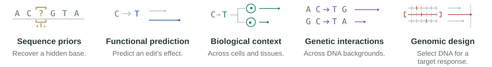
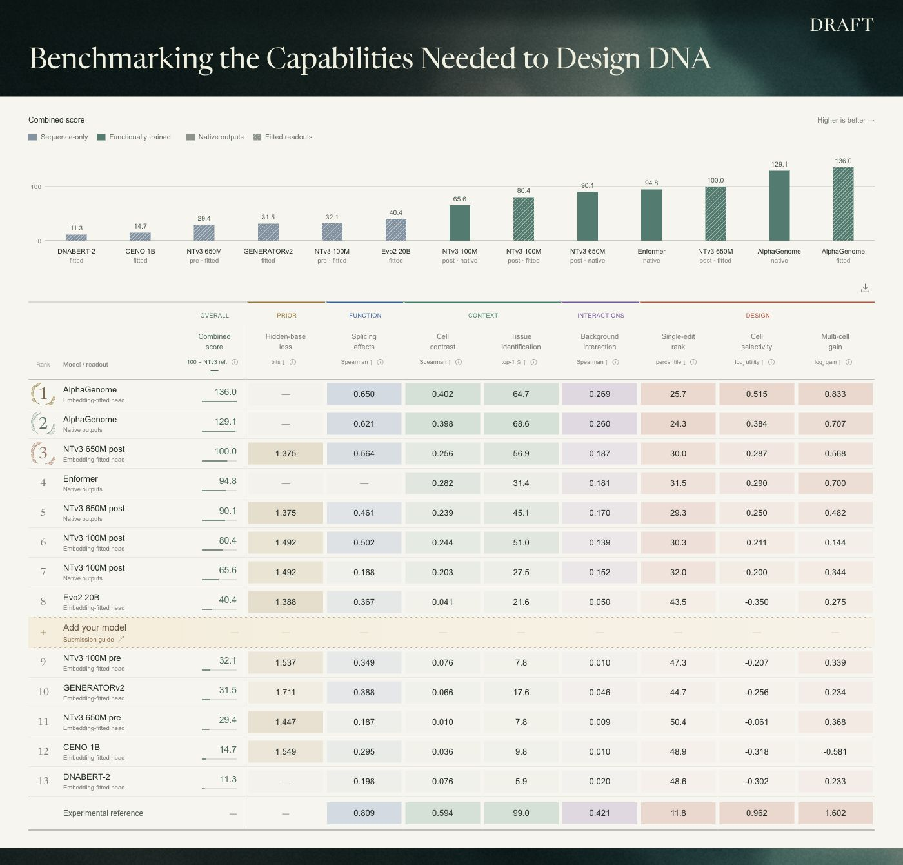

We built DRAFT to test whether genomic models can guide the design of DNA. Across eight tasks, we examine how they predict sequence function, account for cell type and genetic background, and choose sequences that produce a desired response.

<picture>
  <source media="(max-width: 600px) and (prefers-color-scheme: dark)" srcset="docs/assets/capabilities-narrow-dark.svg">
  <source media="(max-width: 600px)" srcset="docs/assets/capabilities-narrow-light.svg">
  <source media="(prefers-color-scheme: dark)" srcset="docs/assets/capabilities-wide-dark.svg">
  
</picture>

<!-- BEGIN REFERENCE RESULTS -->
## Benchmark results

[](docs/assets/leaderboard-preview.jpg)

<details>
<summary>Results as a text table</summary>

| Model / readout | Combined<br>score ↑ | Hidden-base<br>loss<br>bits&nbsp;↓ | Splicing<br>effects<br>Spearman&nbsp;↑ | Cell<br>contrast<br>Spearman&nbsp;↑ | Tissue<br>identification<br>top-1&nbsp;%&nbsp;↑ | Background<br>interaction<br>Spearman&nbsp;↑ | Single-edit<br>rank<br>percentile&nbsp;↓ | Cell<br>selectivity<br>log₂&nbsp;utility&nbsp;↑ | Multi-cell<br>gain<br>log₂&nbsp;gain&nbsp;↑ |
| :--- | ---: | ---: | ---: | ---: | ---: | ---: | ---: | ---: | ---: |
| AlphaGenome<br><sub>Fitted&nbsp;readouts</sub> | 136.0 | — | 0.650 | 0.402 | 64.7 | 0.269 | 25.7 | 0.515 | 0.833 |
| AlphaGenome<br><sub>Native&nbsp;outputs</sub> | 129.1 | — | 0.621 | 0.398 | 68.6 | 0.260 | 24.3 | 0.384 | 0.707 |
| NTv3&nbsp;650M&nbsp;post<br><sub>Fitted&nbsp;readouts</sub> | 100.0 | 1.375 | 0.564 | 0.256 | 56.9 | 0.187 | 30.0 | 0.287 | 0.568 |
| Enformer<br><sub>Native&nbsp;outputs</sub> | 94.8 | — | — | 0.282 | 31.4 | 0.181 | 31.5 | 0.290 | 0.700 |
| NTv3&nbsp;650M&nbsp;post<br><sub>Native&nbsp;outputs</sub> | 90.1 | 1.375 | 0.461 | 0.239 | 45.1 | 0.170 | 29.3 | 0.250 | 0.482 |
| NTv3&nbsp;100M&nbsp;post<br><sub>Fitted&nbsp;readouts</sub> | 80.4 | 1.492 | 0.502 | 0.244 | 51.0 | 0.139 | 30.3 | 0.211 | 0.144 |
| NTv3&nbsp;100M&nbsp;post<br><sub>Native&nbsp;outputs</sub> | 65.6 | 1.492 | 0.168 | 0.203 | 27.5 | 0.152 | 32.0 | 0.200 | 0.344 |
| Evo2&nbsp;20B<br><sub>Fitted&nbsp;readouts</sub> | 40.4 | 1.388 | 0.367 | 0.041 | 21.6 | 0.050 | 43.5 | -0.350 | 0.275 |
| NTv3&nbsp;100M&nbsp;pre<br><sub>Fitted&nbsp;readouts</sub> | 32.1 | 1.537 | 0.349 | 0.076 | 7.8 | 0.010 | 47.3 | -0.207 | 0.339 |
| GENERATORv2<br><sub>Fitted&nbsp;readouts</sub> | 31.5 | 1.711 | 0.388 | 0.066 | 17.6 | 0.046 | 44.7 | -0.256 | 0.234 |
| NTv3&nbsp;650M&nbsp;pre<br><sub>Fitted&nbsp;readouts</sub> | 29.4 | 1.447 | 0.187 | 0.010 | 7.8 | 0.009 | 50.4 | -0.061 | 0.368 |
| CENO&nbsp;1B<br><sub>Fitted&nbsp;readouts</sub> | 14.7 | 1.549 | 0.295 | 0.036 | 9.8 | 0.010 | 48.9 | -0.318 | -0.581 |
| DNABERT-2<br><sub>Fitted&nbsp;readouts</sub> | 11.3 | — | 0.198 | 0.076 | 5.9 | 0.020 | 48.6 | -0.302 | 0.233 |
| Experimental&nbsp;reference | — | — | 0.809 | 0.594 | 99.0 | 0.421 | 11.8 | 0.962 | 1.602 |

</details>
<!-- END REFERENCE RESULTS -->

## Evaluate your model

DRAFT prepares the data and fits readouts to your model’s frozen embeddings.
Install in your model's environment with **Python 3.11 or later**:

```bash
python -m pip install -e .
```

Install your model's framework and weights separately.

[Leaderboard preview](docs/assets/leaderboard-preview.jpg) · [Model guide](docs/models.md) · [Data and licenses](docs/data.md)

This is the anonymous review edition of **DNA Design Readiness Across Functional Tasks (DRAFT)**.
Install it from this source checkout. It includes the smaller task datasets;
for larger inputs, follow the [data guide](docs/data.md). Public project links
and automatic publication are omitted for review. The screenshot above illustrates
the leaderboard; this edition contains the evaluation and submission code.
[Reference results](data/benchmark.paper.json) and their
[source records](data/sources.md) are included.

### Connect an encoder

Save this as `my_model.py`, replacing `your_encoder` with your model's inference:

```python
import numpy as np
from draft import Model


def embed(sequences: list[str]) -> np.ndarray:
    return your_encoder(sequences)  # [batch, features]


model = Model("My model", embed=embed, revision="checkpoint-v1")
```

Return one finite, fixed-width CPU NumPy vector per complete sequence, in input
order. Use your actual checkpoint revision. The [model guide](docs/models.md)
covers pooling, model declarations and the nucleotide-probability interface.

### Run a first task

Start with Atlas: 7,657 short sequences, sixteen multi-cell design requests,
and data included with the package.

```bash
draft run my_model.py --tasks atlas_profile --output results/my-model
draft show results/my-model
```

<details>
<summary>Try an included example first</summary>

Run the base-composition baseline on CPU, without model weights:

```bash
draft run composition --tasks atlas_profile --output results/composition
```

`draft init my_model.py` writes an editable version of this example.
[Included adapters](docs/models.md#included-adapters) cover DNABERT-2, NTv3 and
HyenaDNA. The [model guide](docs/models.md#embeddings) also shows Python usage
with an encoder already in memory.

</details>

## Read the results

Reopen a saved run without loading the model:

```python
from draft import Run

run = Run("results/my-model")
scores = run.to_dataframe()
predictions = run.table("atlas_profile")
```

The result directory keeps scores and predictions as JSON and Parquet files.
`run.tables` lists the available tables; `run.table("atlas_profile", "requests")`
opens the design requests. Use `columns=[...]` to read selected columns.

## Choose the next task

Seven tasks use embeddings; sequence priors need nucleotide probabilities.
Run the subset your model supports.

| Task or group | What it tests |
| :--- | :--- |
| `atlas_profile` | Multi-cell design |
| `prior` | Hidden bases |
| `opensplice` | Splice effects |
| `siraj` | Four regulatory tasks |
| `tissue_identification` | Tissue identity |

`siraj` runs `context`, `background`, `repair_percentile` and `cell_selective`
together, sharing inference work. You can also pass individual task IDs,
a comma-separated list, or `all` for all compatible tasks.

Check input lengths and downloads before starting a larger run:

```bash
draft plan my_model.py --tasks siraj
draft run my_model.py --tasks siraj --output results/my-model
```

See [tasks & compute](docs/tasks.md) for requirements, scores and biological
holdouts. Long-context tissue identification needs the `genome` extra.

<details>
<summary>Resume or combine runs</summary>

Repeat a command to resume. If inference runs out of memory, lower `--batch-size`;
completed batches remain cached. A changed checkpoint, preprocessing, task
protocol or numeric runtime requires a new output directory. Compatible updates
to DRAFT and changes to descriptive metadata preserve completed work.

To combine tasks evaluated in separate jobs:

```bash
draft combine results/my-model results/my-model-siraj --output results/combined
```

Use the same adapter, model revision, declarations and inference settings in each
job. Duplicate tasks must agree. Continue evaluations in the source runs and
combine them again into a new directory. A combined run can be read or submitted.
The Python equivalent is `combine(["results/my-model", "results/my-model-siraj"],
output="results/combined")`, imported from `draft`.

</details>

## Add your model to the leaderboard

Submit any subset of the eight tasks. Maintainers review the model setup and
rescore the saved predictions before accepting a submission. Runs stay local
until you choose to share them.

**[Prepare a submission →](docs/submitting.md)**

[Data and licenses](docs/data.md) · [Contributing](CONTRIBUTING.md) · [Citation](CITATION.cff)
